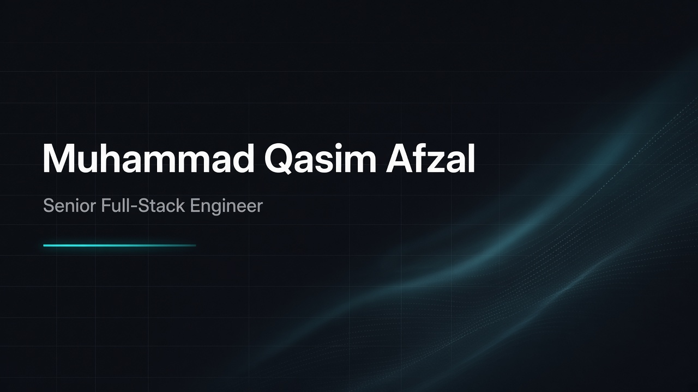

<!--
  Upload BOTH files to designerweb485/designerweb485 repo root:
  - README.md  (this file)
  - github_header.jpg  (short 1280×168 banner — NOT the old tall 16:9)
-->

 

 

I ship **production healthcare systems** end-to-end — UI · API · data · integrations · deploy  
Lahore, Pakistan · 6+ years

---

### Featured project

#### [Claim Checker](https://github.com/designerweb485/claim-checker) — Synthetic X12 837P validation

Medical billing teams catch structural EDI mistakes late.  
Deterministic rules · org-scoped API · upload → parse → validate → findings → CSV

  
  &nbsp;
  

 

[Repo](https://github.com/designerweb485/claim-checker) · [Case study](https://github.com/designerweb485/claim-checker/blob/main/docs/case-study.md) · [Demo](https://github.com/designerweb485/claim-checker/blob/main/docs/demo.md)

Synthetic fixtures only · Not HIPAA / X12 IG certified

---

### Experience

 **[Medsynthea](https://medsynthea.com/)** · Senior Software Engineer  
FHIR R4 · Epic · Athena · eCW · Oracle Health · Office Ally · X12 270/271 · Stedi · Availity · Optum

 **[Ethisol](https://ethisol.com/)** · Full-Stack (Contract)  
MERN · Laravel · AWS

 **[DocNow](https://docnow.ai/)** · MEAN Stack Developer  
Post-acute EHR · Angular · Node.js · MongoDB · JWT · RBAC

---

### Also shipped

---

### Stack

---

### Let's build

Open to **senior full-stack roles** and **freelance product builds**

