<a href="https://github.com/designerweb485"><picture><source media="(prefers-color-scheme: dark) and (max-width: 600px)" srcset="assets/hero-phone-dark.svg"><source media="(max-width: 600px)" srcset="assets/hero-phone-light.svg"><source media="(prefers-color-scheme: dark)" srcset="assets/hero-dark.svg">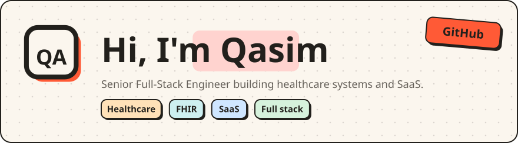</picture></a>

<a href="https://github.com/designerweb485"><picture><source media="(prefers-color-scheme: dark)" srcset="assets/badge-gh-dark.svg">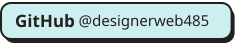</picture></a>
<a href="https://www.linkedin.com/in/muhammad-qasim-afzal/"><picture><source media="(prefers-color-scheme: dark)" srcset="assets/badge-li-dark.svg"></picture></a>
<a href="mailto:afzalqasim30@gmail.com"><picture><source media="(prefers-color-scheme: dark)" srcset="assets/badge-email-dark.svg"></picture></a>

<picture><source media="(prefers-color-scheme: dark) and (max-width: 600px)" srcset="assets/github-phone-dark.svg"><source media="(max-width: 600px)" srcset="assets/github-phone-light.svg"><source media="(prefers-color-scheme: dark)" srcset="assets/github-dark.svg">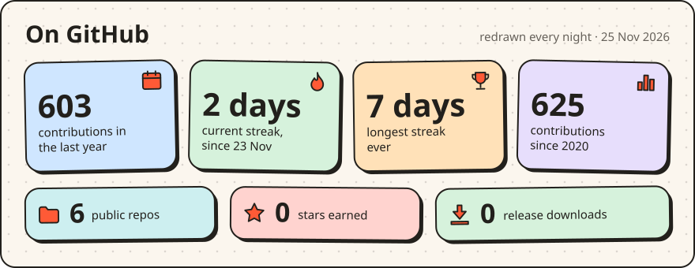</picture>

<picture><source media="(prefers-color-scheme: dark) and (max-width: 600px)" srcset="assets/graph-6m-phone-dark.svg"><source media="(max-width: 600px)" srcset="assets/graph-6m-phone-light.svg"><source media="(prefers-color-scheme: dark)" srcset="assets/graph-6m-dark.svg">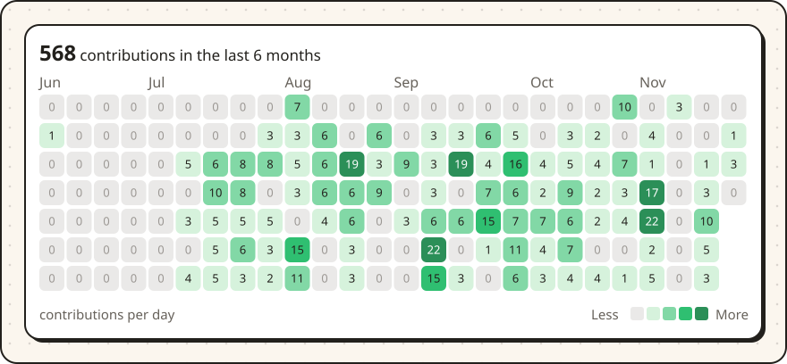</picture>

Last 12 months: 603 contributions

<picture><source media="(prefers-color-scheme: dark) and (max-width: 600px)" srcset="assets/graph-12m-phone-dark.svg"><source media="(max-width: 600px)" srcset="assets/graph-12m-phone-light.svg"><source media="(prefers-color-scheme: dark)" srcset="assets/graph-12m-dark.svg">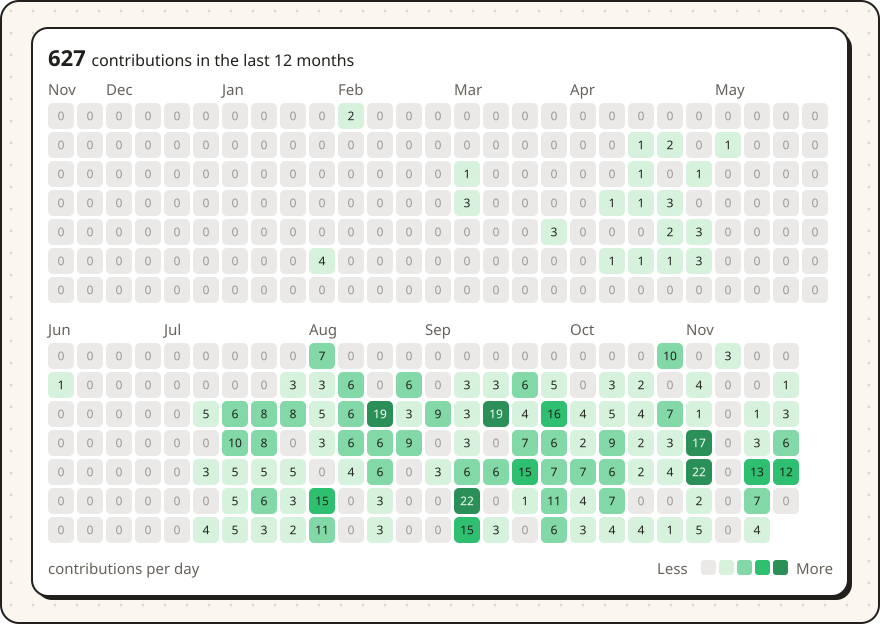</picture>

2026: 603 contributions

<picture><source media="(prefers-color-scheme: dark) and (max-width: 600px)" srcset="assets/graph-2026-phone-dark.svg"><source media="(max-width: 600px)" srcset="assets/graph-2026-phone-light.svg"><source media="(prefers-color-scheme: dark)" srcset="assets/graph-2026-dark.svg">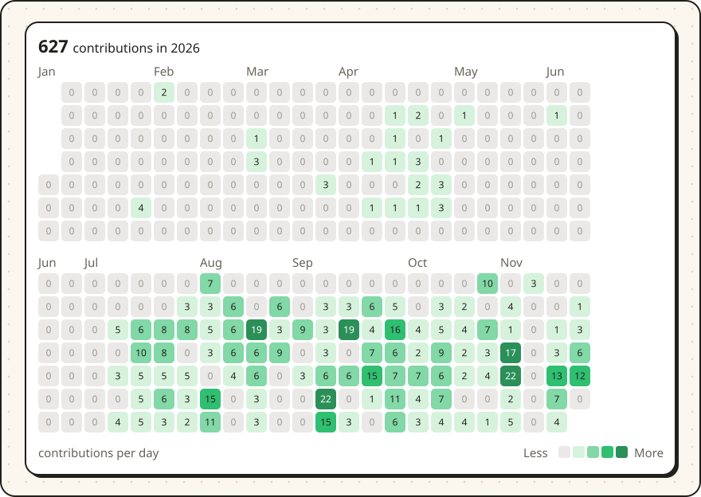</picture>

2022: 3 contributions

<picture><source media="(prefers-color-scheme: dark) and (max-width: 600px)" srcset="assets/graph-2022-phone-dark.svg"><source media="(max-width: 600px)" srcset="assets/graph-2022-phone-light.svg"><source media="(prefers-color-scheme: dark)" srcset="assets/graph-2022-dark.svg">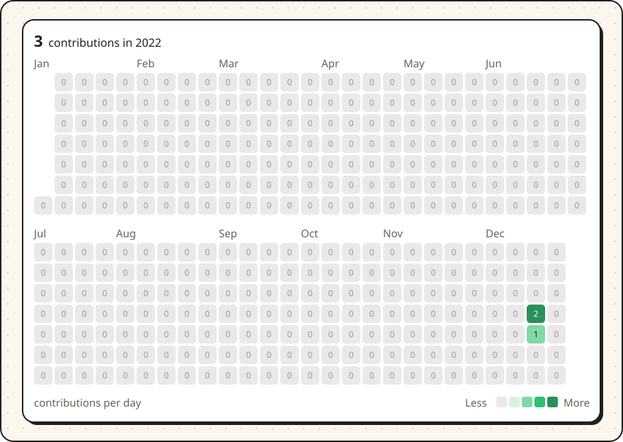</picture>

2021: 4 contributions

<picture><source media="(prefers-color-scheme: dark) and (max-width: 600px)" srcset="assets/graph-2021-phone-dark.svg"><source media="(max-width: 600px)" srcset="assets/graph-2021-phone-light.svg"><source media="(prefers-color-scheme: dark)" srcset="assets/graph-2021-dark.svg">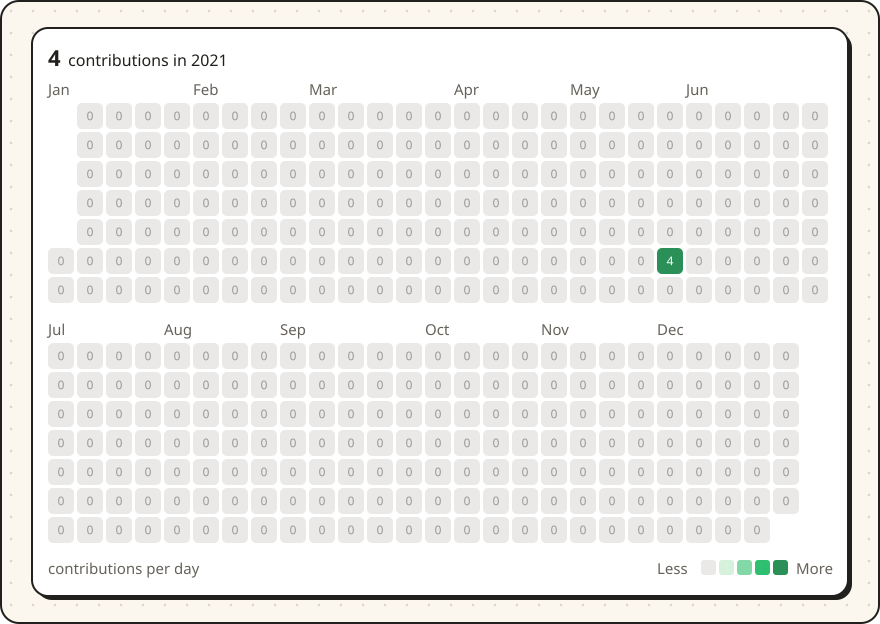</picture>

2020: 15 contributions

<picture><source media="(prefers-color-scheme: dark) and (max-width: 600px)" srcset="assets/graph-2020-phone-dark.svg"><source media="(max-width: 600px)" srcset="assets/graph-2020-phone-light.svg"><source media="(prefers-color-scheme: dark)" srcset="assets/graph-2020-dark.svg">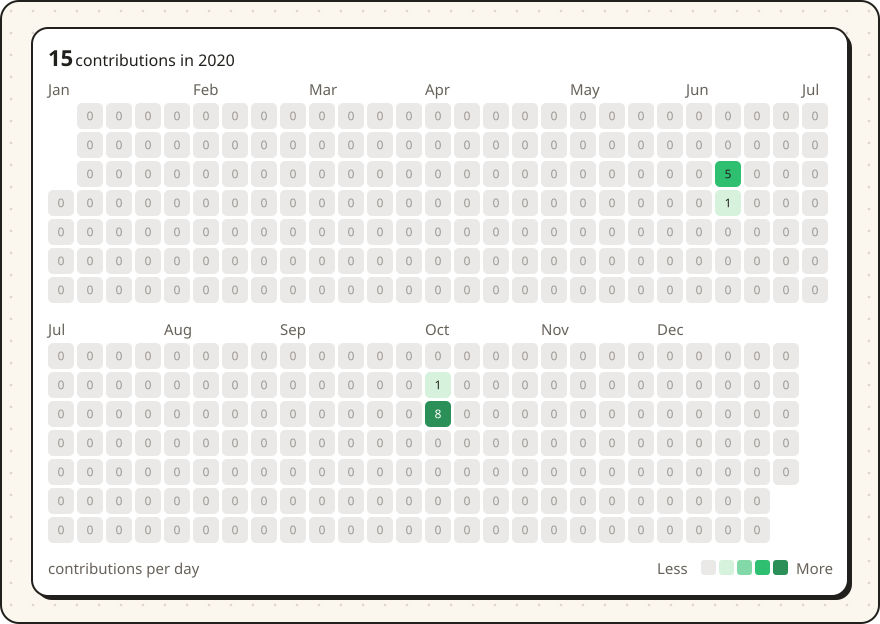</picture>

<picture><source media="(prefers-color-scheme: dark) and (max-width: 600px)" srcset="assets/line-30d-phone-dark.svg"><source media="(max-width: 600px)" srcset="assets/line-30d-phone-light.svg"><source media="(prefers-color-scheme: dark)" srcset="assets/line-30d-dark.svg">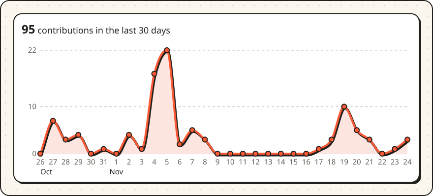</picture>

<picture><source media="(prefers-color-scheme: dark) and (max-width: 600px)" srcset="assets/whoami-phone-dark.svg"><source media="(max-width: 600px)" srcset="assets/whoami-phone-light.svg"><source media="(prefers-color-scheme: dark)" srcset="assets/whoami-dark.svg"></picture>

<picture><source media="(prefers-color-scheme: dark) and (max-width: 600px)" srcset="assets/label-ship-phone-dark.svg"><source media="(max-width: 600px)" srcset="assets/label-ship-phone-light.svg"><source media="(prefers-color-scheme: dark)" srcset="assets/label-ship-dark.svg"></picture>

<a href="https://github.com/designerweb485/claim-checker"><picture><source media="(prefers-color-scheme: dark) and (max-width: 600px)" srcset="assets/app-claim-checker-phone-dark.svg"><source media="(max-width: 600px)" srcset="assets/app-claim-checker-phone-light.svg"><source media="(prefers-color-scheme: dark)" srcset="assets/app-claim-checker-dark.svg">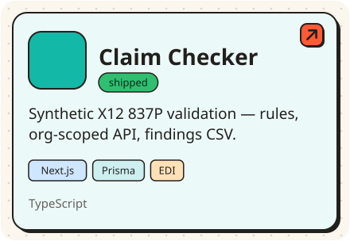</picture></a>
<a href="https://medsynthea.com/"><picture><source media="(prefers-color-scheme: dark) and (max-width: 600px)" srcset="assets/app-medsynthea-phone-dark.svg"><source media="(max-width: 600px)" srcset="assets/app-medsynthea-phone-light.svg"><source media="(prefers-color-scheme: dark)" srcset="assets/app-medsynthea-dark.svg">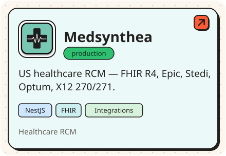</picture></a>
<a href="https://docnow.ai/"><picture><source media="(prefers-color-scheme: dark) and (max-width: 600px)" srcset="assets/app-docnow-phone-dark.svg"><source media="(max-width: 600px)" srcset="assets/app-docnow-phone-light.svg"><source media="(prefers-color-scheme: dark)" srcset="assets/app-docnow-dark.svg">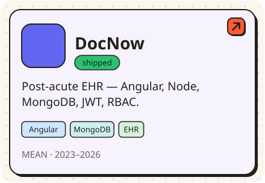</picture></a>
<a href="https://tradin.pk/"><picture><source media="(prefers-color-scheme: dark) and (max-width: 600px)" srcset="assets/app-tradin-phone-dark.svg"><source media="(max-width: 600px)" srcset="assets/app-tradin-phone-light.svg"><source media="(prefers-color-scheme: dark)" srcset="assets/app-tradin-dark.svg">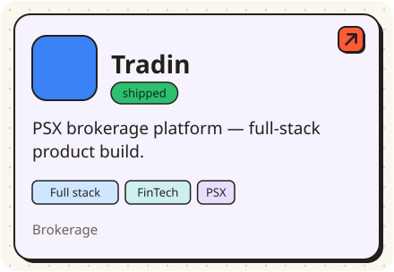</picture></a>

More ships: <a href="https://acsas.co/">ACSAS</a> · <a href="https://ethisol.com/">Ethisol</a> · <a href="https://github.com/designerweb485/qasim-afzal-portfolio">Portfolio</a> · <a href="https://github.com/designerweb485/Onlinefood.com">Onlinefood</a>

Drawn in the ZazaG-style sticker design system · numbers redrawn by a GitHub Action · <a href="https://www.linkedin.com/in/muhammad-qasim-afzal/">LinkedIn</a> · <a href="https://github.com/designerweb485">GitHub</a>

