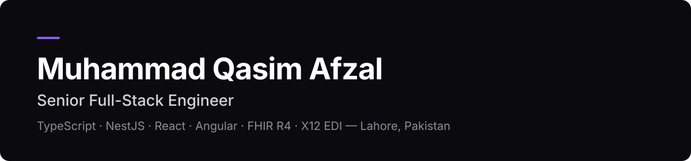

# Muhammad Qasim Afzal

Senior Full-Stack Engineer — Lahore, Pakistan
Currently Senior Software Engineer at Medsynthea.

I build production healthcare systems and SaaS products end-to-end: frontend, API, database, and deployment.

## Featured Project

**Claim Checker** — Synthetic X12 837P claim validation for medical billing teams.

- Deterministic validation engine — same input, same findings, every time
- Org-scoped API with audit boundaries — no raw EDI in logs
- Full pipeline: upload → parse → validate → findings → CSV export

Next.js · Express · Prisma · PostgreSQL · Docker · GitHub Actions

[Repository](https://github.com/designerweb485/claim-checker) · [Case study](https://github.com/designerweb485/claim-checker/blob/main/docs/case-study.md) · [Demo](https://github.com/designerweb485/claim-checker/blob/main/docs/demo.md)

## Work

**[Medsynthea](https://medsynthea.com/)** — Senior Software Engineer, 2026–Present
EHR integrations with Epic, Athenahealth, eClinicalWorks, Oracle Health, and Office Ally over FHIR R4. Real-time eligibility and claims via X12 270/271 through Stedi, Availity, and Optum. HIPAA-compliant backend systems.

**Ethisol** — Full-Stack Developer (Contract), 2026–Present
MERN and Laravel applications on AWS.

**[DocNow](https://docnow.ai/)** — MEAN Stack Developer, 2023–2026
EHR product built with Angular, Node.js, and MongoDB. Authentication with JWT and role-based access control.

6+ years shipping software. Full history: [LinkedIn](https://www.linkedin.com/in/muhammad-qasim-afzal/)

## What I own end-to-end

- Product frontends in React and Angular
- APIs and services in Node.js and NestJS
- Data, auth, and integrations — FHIR R4, X12, REST, third-party APIs
- Deployment and operation on AWS

## Stack

TypeScript, JavaScript, React, Angular, Node.js, NestJS, MongoDB, Laravel, AWS, FHIR R4, X12 EDI

## Projects

[Claim Checker](https://github.com/designerweb485/claim-checker) — Synthetic X12 837P claim validation. Next.js, Express, Prisma, PostgreSQL, Docker, CI. Screenshots and case study in the repo.
[Tissue ERP](https://tradin.pk/) — Velvex tissue (client project, private repo). Next.js and TypeScript ERP covering inventory, production, sales, purchases, dispatch and gate-pass, customer and vendor ledgers, and reporting.
[Tradin](https://tradin.pk/) — Online stock trading platform for Pakistan.
[ACSAS](https://acsas.co/) — Website for a fractional CFO and accounting services firm.
[Portfolio](https://github.com/designerweb485/qasim-afzal-portfolio) — Personal portfolio. TypeScript.
[Online Food](https://github.com/designerweb485/Onlinefood.com) — Food ordering frontend. [Live demo](https://designerweb485.github.io/Onlinefood.com/)

## Contact

Open to senior full-stack roles and freelance product builds.

[LinkedIn](https://www.linkedin.com/in/muhammad-qasim-afzal/) · [GitHub](https://github.com/designerweb485)
